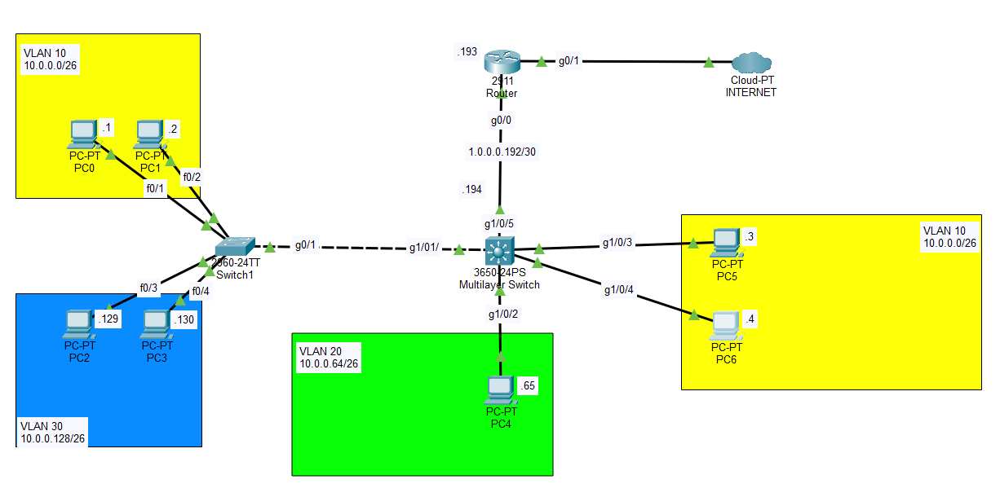
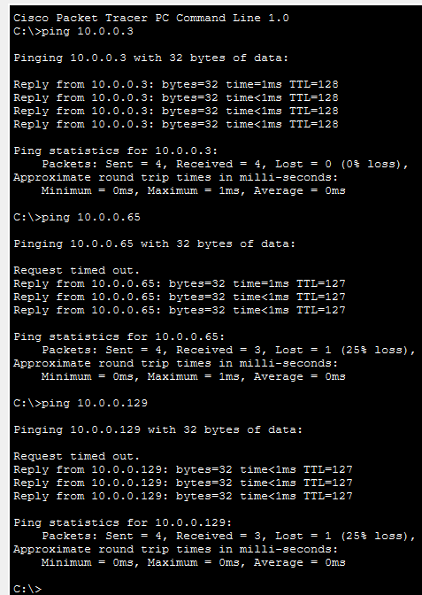

# Inter-VLAN Routing via Layer 3 Multilayer Switch

A Cisco Packet Tracer implementation demonstrating efficient **Inter-VLAN routing** utilizing a **Layer 3 Multilayer Switch (3650)** and **Switch Virtual Interfaces (SVIs)**. This project highlights a high-performance network topology designed to enable secure, line-rate routing between multiple distinct subnets without routing bottlenecks.

## 📊 Network Topology Overview

This layout segments the corporate LAN into three functional broadcast domains (VLANs) while routing external public traffic through a dedicated transit network up to the Internet boundary:

| VLAN ID | Subnet | Purpose / Department | SVI IP / Gateway |
| :--- | :--- | :--- | :--- |
| **VLAN 10** | `10.0.0.0/26` | Management / Hosts | `10.0.0.62` |
| **VLAN 20** | `10.0.0.64/26` | Engineering / Servers | `10.0.0.126` |
| **VLAN 30** | `10.0.0.128/26` | Finance / Guest | `10.0.0.190` |
| **Transit Link** | `10.0.0.192/30` | Layer 3 Routed Link (Switch to Router) | `Switch: .193` \| `Router: .194` |



## 🛠️ Core Technologies & Concepts Implemented

*   **Layer 3 Routed Ports:** Converted physical switchports using the `no switchport` command to establish a direct point-to-point IP link between the Core Switch and the Perimeter Router.
*   **Switch Virtual Interfaces (SVIs):** Configured logical Layer 3 interfaces per VLAN on the Multilayer Switch to serve as the default gateways for the endpoints.
*   **Layer 3 IP Routing:** Activated the structural hardware routing engine on the Cisco 3650 switch via the `ip routing` directive.
*   **Static & Gateway Configuration:** Established a default route (`0.0.0.0/0`) on the switch pointing towards the boundary router to ensure internet accessibility.
*   **Loopback Internet Simulation:** Provisioned a virtual internal `loopback 0` interface (`1.1.1.1`) inside the boundary framework to simulate cloud/internet connectivity responses natively without adding unnecessary server endpoints.

## ⚙️ Key Configuration Snips

### 1. Multilayer Switch Core Routing Activation
```text
Switch(config)# ip routing
Switch(config)# interface gigabitEthernet 1/0/5
Switch(config-if)# no switchport
Switch(config-if)# ip address 10.0.0.193 255.255.255.252
Switch(config-if)# no shutdown
```

### 2. SVI Gateway Assignment (Example: VLAN 10)
```text
Switch(config)# interface vlan 10
Switch(config-if)# ip address 10.0.0.62 255.255.255.192
Switch(config-if)# no shutdown
```

### 3. Edge Router Internet Emulation
```text
Router(config)# interface loopback 0
Router(config-if)# ip address 1.1.1.1 255.255.255.255
```

## ✅ Verification & Testing

Inter-VLAN connectivity and default gateway functionality were completely verified by initiating end-to-end ICMP ping traffic across different broadcast domains. 

*   Successful ping requests confirmed line-rate routing between **VLAN 10, 20, and 30**.
*   Successful public destination testing confirmed proper static route propagation to the network edge (`1.1.1.1`).

Refer to the visual logs file below for exact confirmation metrics:



## 🚀 How to Run the Project
1. Clone this repository to your machine.
2. Ensure you have **Cisco Packet Tracer v8.x** or higher installed.
3. Open the `inter-vlan-routing_multilayer_switch.pkt` source file included in this repository to observe, test, or modify the active topology.

